Google Antigravity recently added [/swarm](https://antigravity.google/docs/swarm/) command that lets you run a team of named agents to divide your task, work in parallel, and sync on a single shared board. It is useful for tasks that split cleanly across files, packages, or questions, or whenever you want a second agent to review and test changes before you see them. I wanted to put the swarm feature to the test by updating multiple NPM packages in parallel to see how it works. Let’s get going!

<!-- more -->

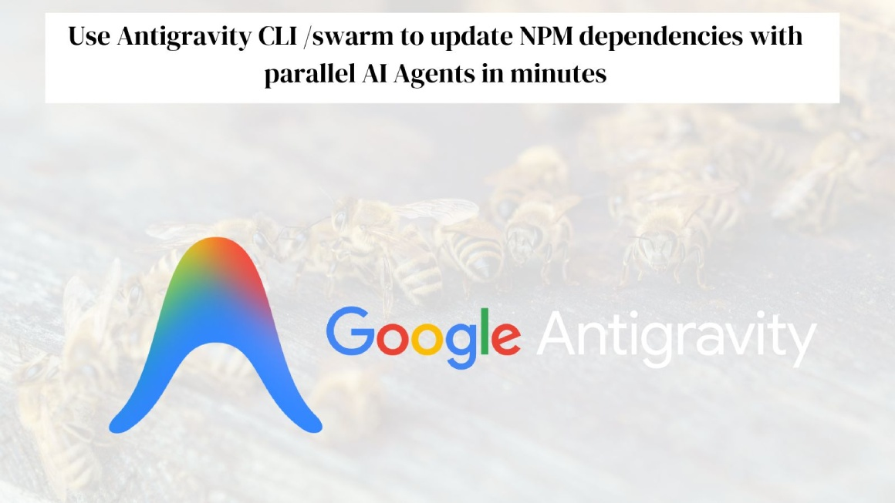

## Table of contents

- [More on Google Antigravity Swarm](#more-on-google-antigravity-swarm)
    - [How it works](#how-it-works)
- [Update NPM packages with Antigravity Swarm](#update-npm-packages-with-antigravity-swarm)
    - [Get a list of outdated NPM packages](#get-a-list-of-outdated-npm-packages)
    - [The prompt to upgrade NPM packages with swarm](#the-prompt-to-upgrade-npm-packages-with-swarm)
- [Conclusion](#conclusion)

## More on Google Antigravity Swarm

Before we get our hands dirty, you will need the Antigravity App or Antigravity CLI installed on your machine. I will do the demo with [Antigravity CLI](https://antigravity.google/product/antigravity-cli/) version 1.5.18. Swarm runs a group of related subagents managed by a coordinator agent. It might sound similar to the `/teamwork` command, but it is different; follow this [table](https://antigravity.google/docs/swarm/#choose-between-swarm-teamwork-boost-and-subagents) to know the difference between subagents, `/boost`, `/teamwork`, and `/swarm`. 

### How it works

To use the `/swarm` command/feature, start your prompt with `/swarm` or use it as part of the prompt. It then internally starts a `coordinator` subagent, which splits the task, names the swarm, and divides the work into non-colliding pieces. After that, it starts a pool of similar workers in a numbered group.

Each worker sub-agent gets a public brief of the work and does its work by communicating on the common board. A verifier checks the work. There is usually one verifier for two to four workers.

All sub-agents talk on the board; workers don’t message each other privately. Idle members sleep to save tokens. The coordinator is the main sub-agent that manages other agents to ensure the task is completed efficiently. It doesn't do the technical work; it distributes work, judges what comes back, and reports to you. It also responds to you while workers run.

It is easy to understand visually, as follows:

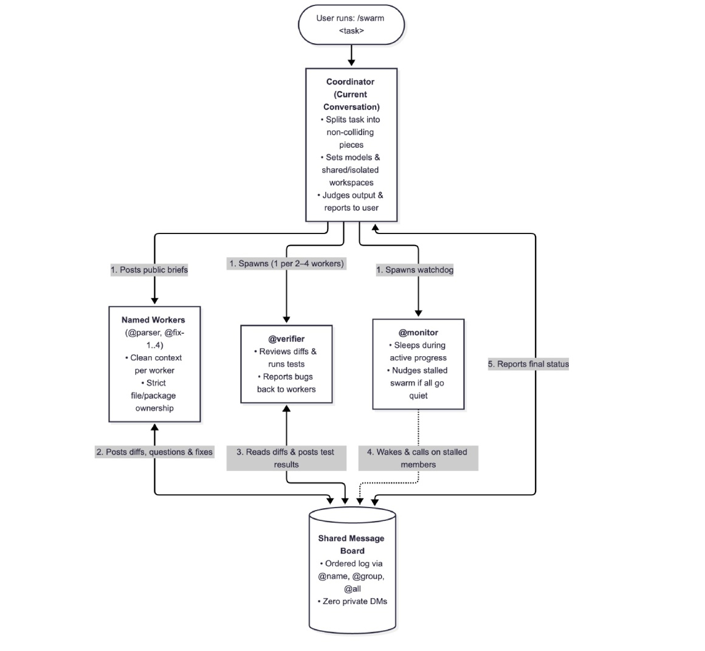

There are also worker states and quota handling involved. You can read more about it in the official swarm documents. In the next section, you will update 10 NPM dependencies/packanges in parallel with `/swarm`.

## Update NPM packages with Antigravity Swarm
NPM packages get out of date quite fast. You can run `npm outdated` to see the outdated packages and `npm audit fix` to fix any security issues with the NPM dependencies. In general practice, these housekeeping tasks do not take priority. When you run them after a few weeks or months, you may find that many packages need to be updated. You can use tools like Dependabot to get a steady stream of packages that need updating, but testing each package upgrade becomes the bottleneck. And when the packages get a major version bump, it can come with breaking changes and other issues.

With that context, this blog is generated with Eleventy. It is also an NPM package, and in this blog I use multiple other NPM packages to support other features like Syntax Highlighting. Below are the steps I took to use `/swarm` with `agy` CLI to update 10 npm packages in parallel in minutes.

### Get a list of outdated NPM packages

To get a list of outdated NPM packages, I ran `npm outdated` on the root of this Eleventy blog, which resulted in:

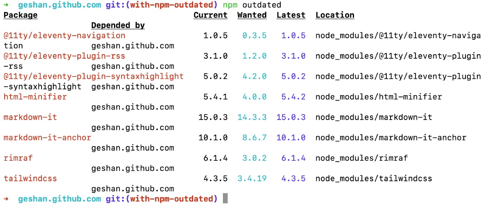

I wanted a simpler upgrade, so I would not upgrade `tailwindcss` as it is a major upgrade and breaking it would impact all the CSS on my blog; my target is to update all the other NPM packages except `tailwindcss`.

### The prompt to upgrade NPM packages with swarm

Therefore, I used the following prompt in the Antigravity CLI (agy in the folder) to upgrade the 10 NPM packages in parallel:

```
using /swarm update all the npm dependencies to the latest version except tailwind, you can update each dependency in it's own agent. Make sure each update is a different commit and after each update ensure that the blog builds. After the whole task is done test 2 pages on the browser
```
Which looks like the following in agy cli:

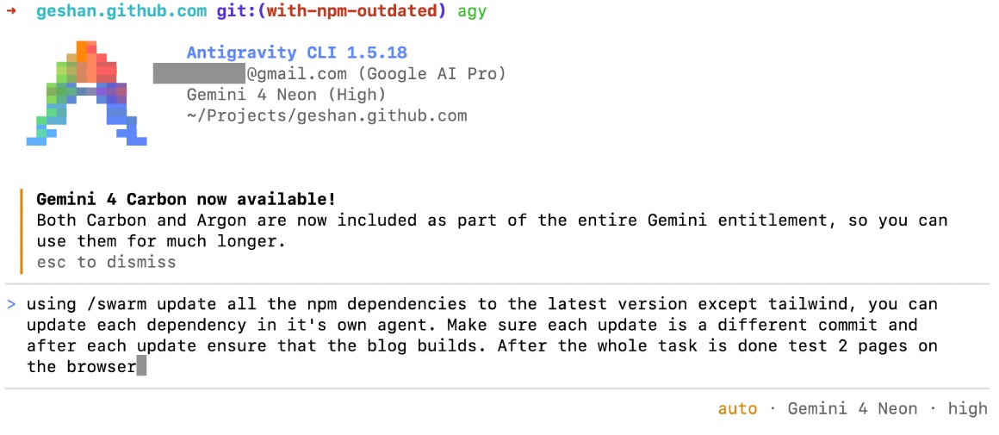

After I ran it, it picked up some skills and started the coordinator. As I had the `agent-browser` skill available, it pulled that in for later testing:

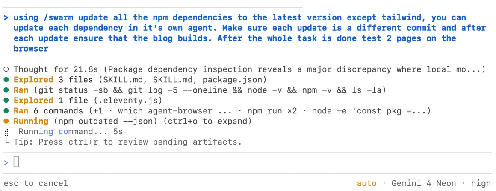

For your reference, I am using the `Gemini 4 Neon` model on `high` capacity. It ran other commands, including `npm outdated –json` to figure out the outdated NPM dependencies.

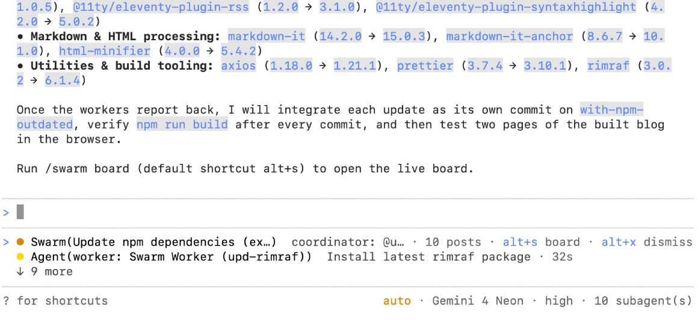

After that, it created the swarm of 10 agents, and each agent was doing it’s part of the work. Workers got their own brief like below:

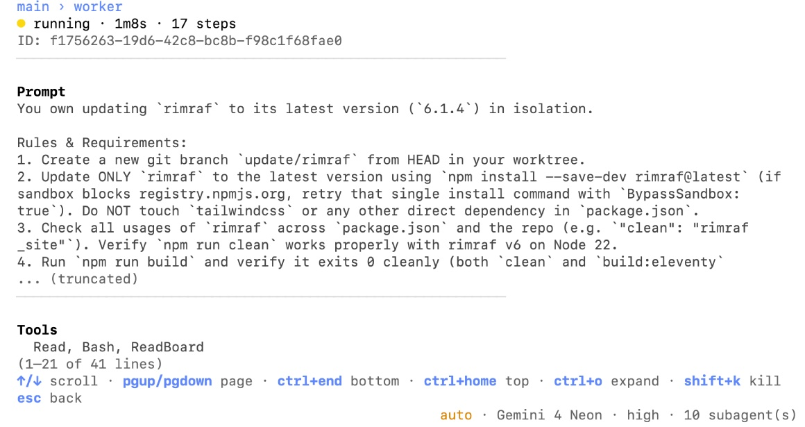

Overall progress of the workers was visible in the swarm board, which looked like this:

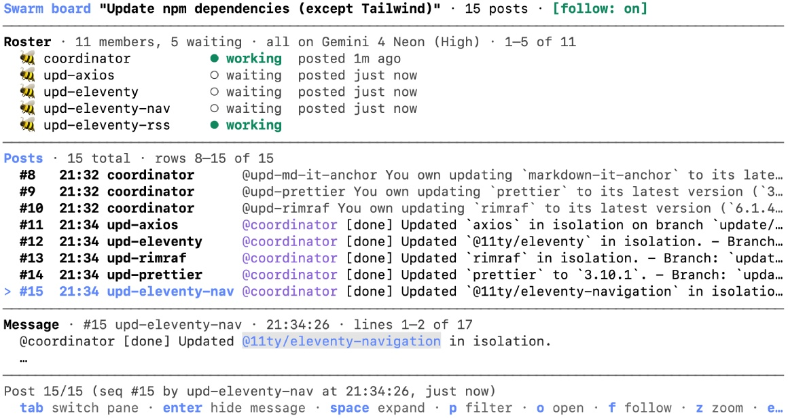

The update was coming in the main conversation too:

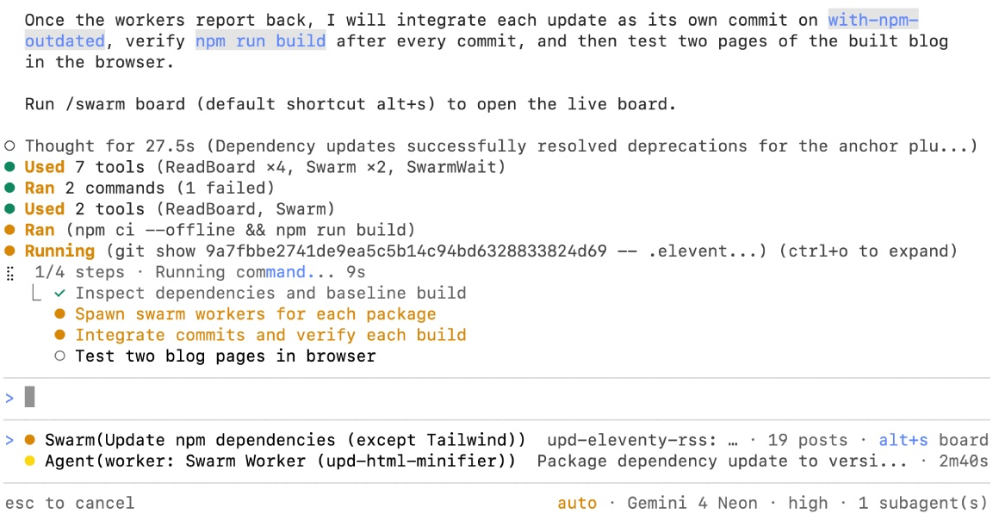

It also updated any related files that needed an update as part of an NPM dependency update.

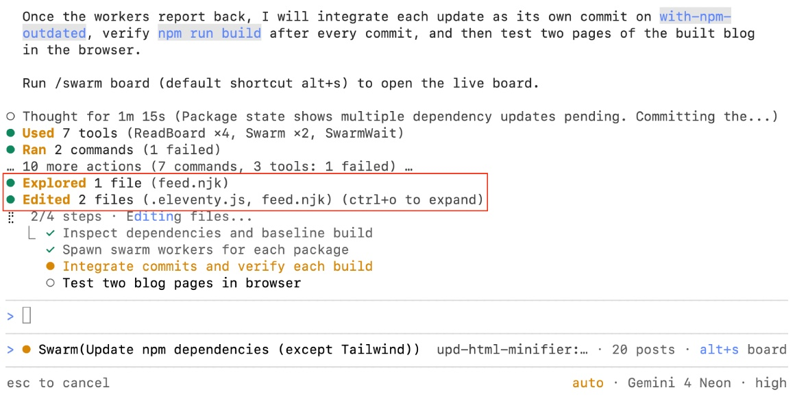

I had to wait a few minutes for it to finish; when I ran `git status` while it was running, I could see `package.json` and `package-lock.json` changing. The `git log -2` command also showed me the commit history.

After the steps, it ran the agent browser to test the two pages.

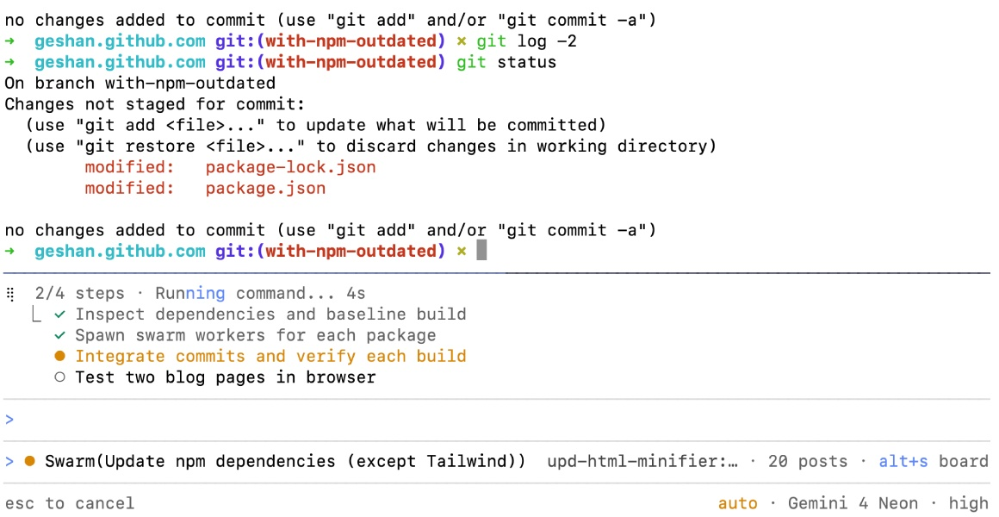

It gave a `QA verification` brief to that worker to test the site:

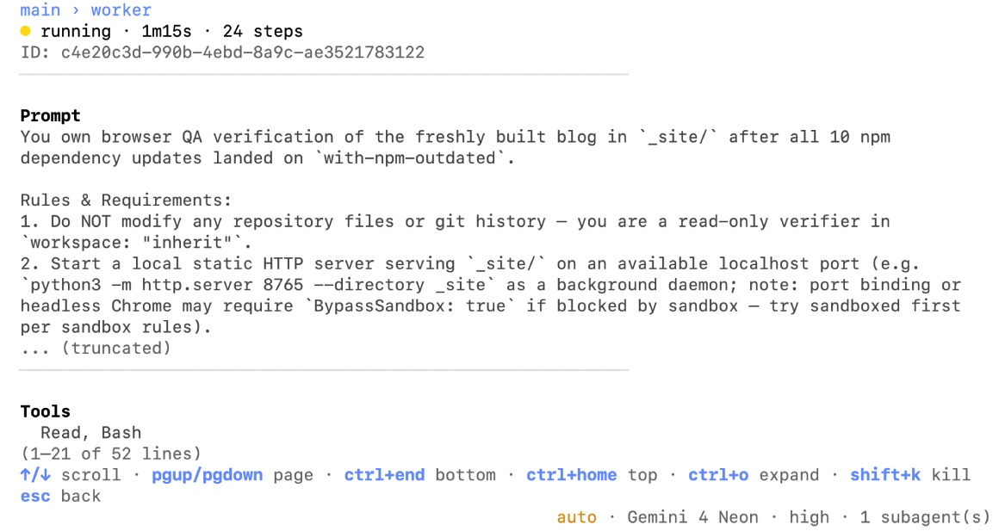

The swarm board looked like the below when the QA was happening:

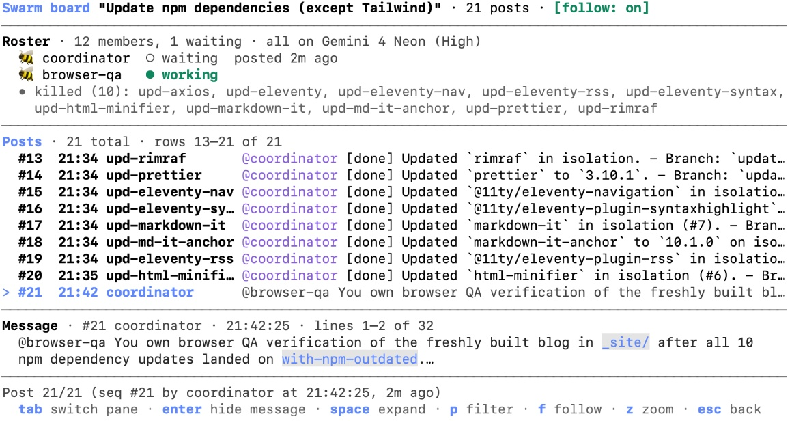

All the communication was happening on the board. Keep in mind it does burn a lot of tokens.
When it was all done, it gave a summary of commits and the result of the browser verification as seen below:

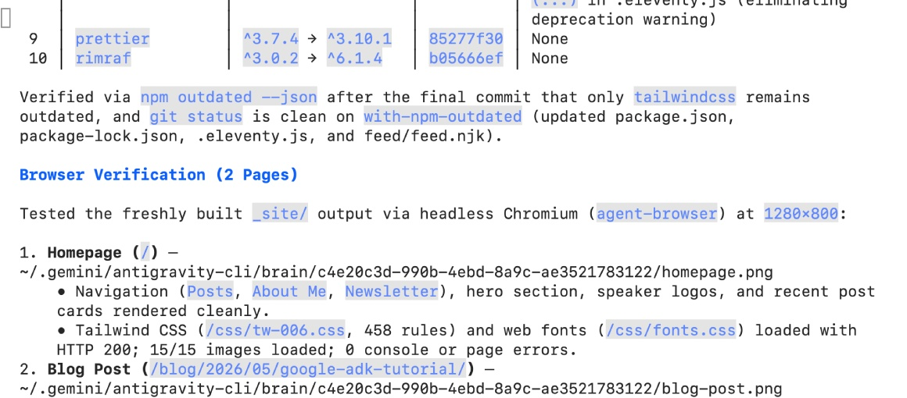

After that, I asked it to push the branch, which it did. These are the [10 commits](https://github.com/geshan/geshan.github.com/compare/source...with-npm-outdated) it made. 

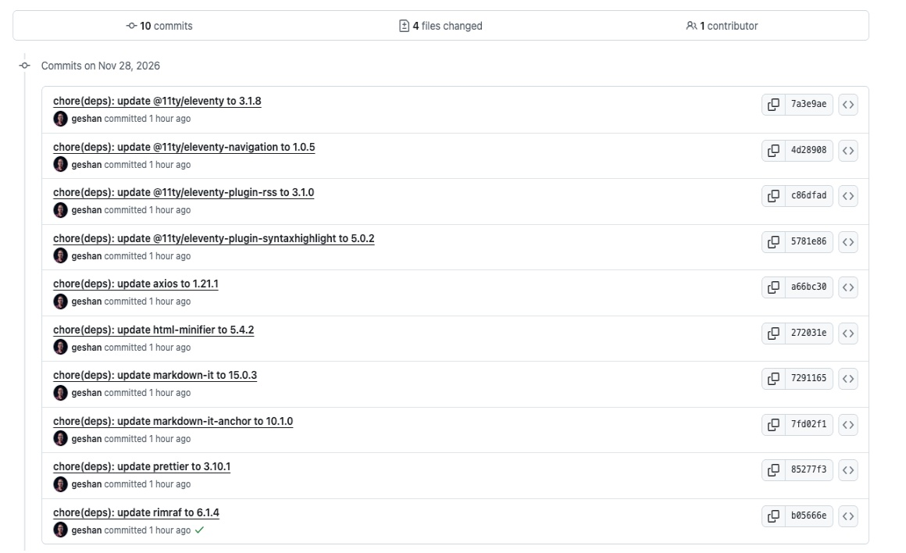

Then, I did a quick check to make sure everything worked, then used the update Antigravity did. I hit `option+x` to clear/dismiss the swarm board as the work was done.

If I had made these changes one by one, it would have taken a long time, but with the `/swarm` command, it was done in minutes, with parallel workers. Next time you have a task that can be divided cleanly into smaller chunks that can be done in parallel, reach out for the `/swarm` feature.

## Conclusion

Coding agents have transformed how we work as software engineers. In this post, you saw a small but practical use of the Antigravity `/swarm` command to update 10 NPM dependencies in parallel. Keep experimenting with new ways to work with AI/Coding agents to stay relevant in this agentic AI era of software engineering, where the discussion is rapidly moving toward a `software factory`. I hope you don’t run out of tokens!
